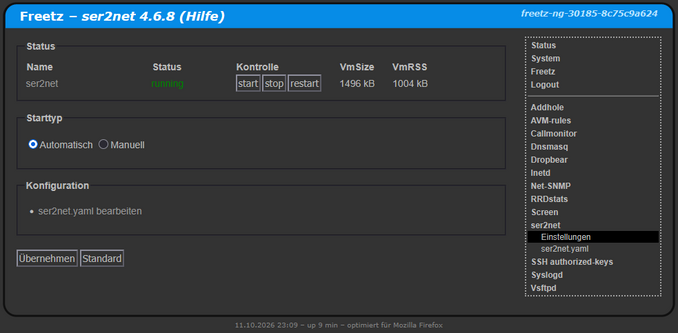

# ser2net 3.5.4/4.6.8
  - Homepage: [https://ser2net.sourceforge.net/](https://ser2net.sourceforge.net/)
  - Manpage: [https://linux.die.net/man/8/ser2net](https://linux.die.net/man/8/ser2net)
  - Changelog: [https://sourceforge.net/p/ser2net/news/](https://sourceforge.net/p/ser2net/news/)
  - Repository: [https://sourceforge.net/projects/ser2net/](https://sourceforge.net/projects/ser2net/)
  - Package: [master/make/pkgs/ser2net/](https://github.com/Freetz-NG/freetz-ng/tree/master/make/pkgs/ser2net/)
  - Steward: [@fda77](https://github.com/fda77)

Mit set2net kann ein lokale serielle Schnittstelle im Netzwerk per Telnet freigegeben werden. 

Anwendungsbeispiele:

  - [http://www.nwlab.net/tutorials/ser2net/konsolenserver-linux.html](http://www.nwlab.net/tutorials/ser2net/konsolenserver-linux.html)
  - [http://www.aufpreis.de/aufpreis/php/ser2netttyredirect.php](http://www.aufpreis.de/aufpreis/php/ser2netttyredirect.php)

Als Windows-Client eignet sich [HW Virtual SerialPort](http://www.hw-group.com/products/hw_vsp/index_de.html).
Auch ein direkter Zugriff über Telnet auf den Netzport von ser2net ist möglich.

Thread im IPPF:

  - [http://www.ip-phone-forum.de/showthread.php?p=1329692](http://www.ip-phone-forum.de/showthread.php?p=1329692)

