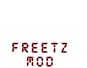
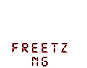
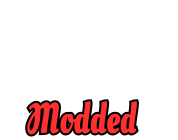

# Tagging

### cuma
Im Webinterface wird über AVM's "Fritz" Logo der Schriftzug "FREETZ MOD" gelegt.  

### Freetz-NG
Im Webinterface wird über AVM's "Fritz" Logo der Schriftzug "FREETZ NG" gelegt.  

### Custom
Im Webinterface wird über AVM's "Fritz" Logo der Schriftzug "Custom" gelegt.  

### Modded
Im Webinterface wird über AVM's "Fritz" Logo der Schriftzug "Modded" gelegt.  

### Pimped
Im Webinterface wird über AVM's "Fritz" Logo der Schriftzug "Pimped" gelegt.  

### Prisrak
Im Webinterface wird über AVM's "Fritz" Logo der Schriftzug "Freetz mod" gelegt.  

